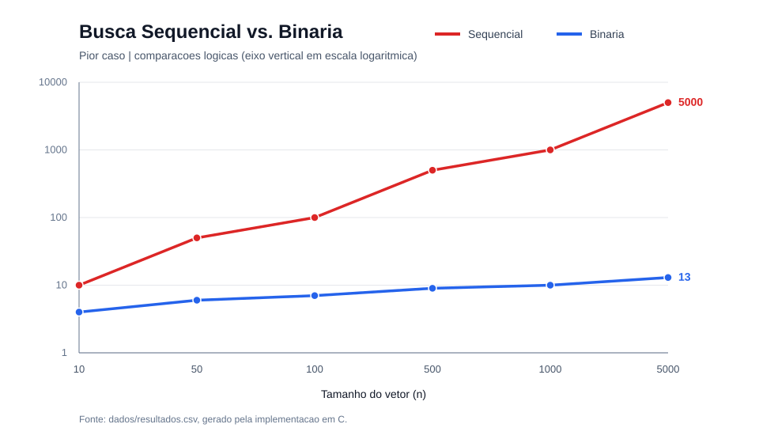

# Busca Sequencial vs. Binária — Versão Interativa

**Projeto 02: Ponto de Inflexão — Comparação Linear vs. Logarítmica**

Programa em **C11** para comparar buscas sobre vetores ordenados. Agora o usuário seleciona o tamanho do vetor e o número a procurar diretamente pelo terminal.

## O que mudou

Ao digitar **`make`**, o programa oferece este fluxo:

1. Escolher **10, 50, 100, 500, 1000 ou 5000** elementos, pelo número da opção **1 a 6** ou pelo tamanho exato.
2. Informar qualquer número inteiro para procurar (positivo, zero ou negativo).
3. Verificar se o alvo foi encontrado e comparar a quantidade de comparações das duas buscas.
4. Salvar a execução no arquivo **`resultado_busca.csv`** (substituído a cada nova busca).

Os vetores seguem a mesma regra do projeto original: **valores pares ordenados** `0, 2, 4, 6, ..., 2 × (n-1)`. Por exemplo, no vetor de 10 elementos os valores são: `0, 2, 4, 6, 8, 10, 12, 14, 16, 18`. Portanto, o número 12 está presente e o número 21 não está.

## Como executar no Kali Linux

Pré-requisitos: `gcc`, `make` e, para gerar o gráfico, `awk`.

```bash
sudo apt update
sudo apt install -y build-essential gawk unzip
cd busca-sequencial-vs-binaria
make
```

**Exemplo de entrada:**

```text
Escolha o tamanho do vetor:
  1) 10 elementos
  2) 50 elementos
  3) 100 elementos
  4) 500 elementos
  5) 1000 elementos
  6) 5000 elementos

Opcao (1 a 6 ou tamanho exato): 1
Numero que deseja procurar: 12
```

**Exemplo de resultado:**

```text
Vetor: 10 elementos ordenados (0, 2, 4, ..., 18).
Valor procurado: 12

BUSCA SEQUENCIAL
  Encontrado! Indice: 6 (posicao 7).
  Comparacoes: 7

BUSCA BINARIA
  Encontrado! Indice: 6 (posicao 7).
  Comparacoes: 4

Razao experimental (sequencial / binaria): 1.75
Razao teorica de crescimento (n / log2(n)): 3.01
```

*Índice* começa em **0**, enquanto a *posição* mostrada para leitura humana começa em **1**.

## Comandos disponíveis

| Comando | Função |
|---|---|
| `make` | **Compila e executa o menu interativo** |
| `make run` | Abre o menu novamente |
| `make compilar` | Compila os dois programas, sem executá-los |
| `make test` | Testa os algoritmos e o fluxo interativo |
| `make dados` | Reproduz os 6 testes automáticos de pior caso em `dados/resultados.csv` |
| `make grafico` | Atualiza o experimento de pior caso e `docs/grafico.svg` |
| `make clean` | Apaga os executáveis e os CSVs temporários da raiz |

Para executar diretamente o programa interativo após compilar:

```bash
./bin/comparador
```

## Diferença entre as buscas

- **Busca sequencial:** examina os números um de cada vez até encontrar o alvo ou alcançar o fim. Seu pior caso cresce proporcionalmente a `n`: **O(n)**.
- **Busca binária:** como os números estão ordenados, compara com o elemento central e elimina uma das metades do intervalo. Seu pior caso cresce com **O(log₂ n)**.
- **Melhor caso:** ambas podem localizar o alvo na primeira inspeção, com **Θ(1)** comparações.
- **Limite firme no pior caso:** **Θ(n)** para a sequencial e **Θ(log₂ n)** para a binária.

A razão experimental usa as **comparações realmente realizadas** na busca escolhida:

`R_experimental = comparacoes_sequencial / comparacoes_binaria`

A razão teórica ilustrativa compara as **funções de crescimento**:

`R_teorica = n / log₂(n)`

A razão teórica não precisa coincidir com a experimental: ela serve para demonstrar como os limites de crescimento se distanciam à medida que `n` aumenta. Ao procurar um alvo escolhido pelo usuário, o número de comparações pode ser muito menor que no pior caso.

## Experimento automático original (pior caso)

O projeto também preserva a experiência acadêmica original. Com `make dados`, cada vetor recebe um **alvo inexistente acima do maior valor**, forçando `n` comparações sequenciais e o caminho mais longo da busca binária nesta implementação.

| Tamanho (`n`) | Sequencial | Binária | Razão experimental |
|---:|---:|---:|---:|
| 10 | 10 | 4 | 2,50 |
| 50 | 50 | 6 | 8,33 |
| 100 | 100 | 7 | 14,29 |
| 500 | 500 | 9 | 55,56 |
| 1000 | 1000 | 10 | 100,00 |
| 5000 | 5000 | 13 | 384,62 |



## Arquivos do projeto

```text
busca-sequencial-vs-binaria/
├── .github/workflows/ci.yml   # Testes no GitHub Actions
├── .gitignore
├── Makefile                     # Comandos make
├── README.md
├── include/buscas.h            # Tipos e funções
├── src/
│   ├── main.c                  # Menu interativo
│   ├── buscas.c                # Algoritmos originais
│   └── experimento.c           # Experimento automático original
├── tests/
│   ├── test_buscas.c           # Testes dos algoritmos
│   └── test_interativo.sh      # Testes do menu
├── scripts/gerar_grafico.awk   # Geração do SVG
├── dados/resultados.csv        # Comparações do pior caso
└── docs/grafico.svg            # Gráfico do pior caso
```

O programa define **uma comparação** como uma inspeção lógica de um elemento em relação ao alvo, por chamada à função comparadora. Não se trata de medição de tempo de CPU.

## Publicar no GitHub

```bash
git init
git add .
git commit -m "Adiciona busca interativa e preserva experimento de pior caso"
```

Depois, configure seu repositório remoto e envie o projeto.
